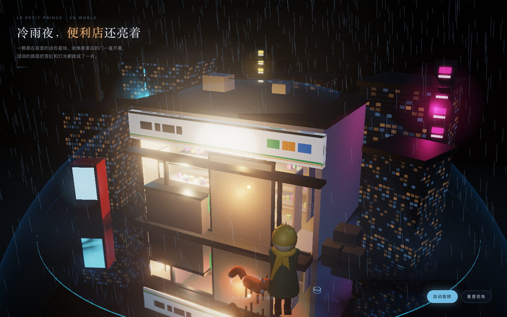

# 小王子 · 冷雨夜便利店 3D 世界

> 一颗悬在夜色里的迷你星球。街角那家日式便利店的门一直亮着，暖光泼在湿透的地面上，雨没停过。

一个可实时交互的 3D 场景：拖动旋转、滚轮缩放，从任何角度看这颗星球。所有几何体、材质、灯光、雨、倒影都由代码在运行时生成 —— 没有外部模型文件，没有贴图素材，整个项目只有 HTML + 一份 JS + 本地 three.js。



## 在线体验

> 部署后补充链接。

## 本地运行

克隆下来，纯静态，无构建步骤、无依赖安装：

```bash
git clone https://github.com/felix6328/little-prince-3d-world.git
cd little-prince-3d-world
python3 -m http.server 5173
```

然后打开 <http://127.0.0.1:5173>。

> 必须通过本地服务器访问。项目使用 ES Module + importmap，直接双击 `index.html`（`file://` 协议）会被浏览器的 CORS 策略拦下。

## 交互

| 操作 | 效果 |
| --- | --- |
| 拖动 | 环绕星球旋转视角 |
| 滚轮 | 拉近 / 推远（已限制最近距离，防止穿模） |
| 右下「自动旋转」 | 缓慢自转，适合当氛围画面 |
| 右下「重置视角」 | 回到默认机位 |

## 场景里有什么

- **星球**：半径 6.4 的球体，顶部切出一块约 9 米的圆形广场作为舞台，边缘留一圈碎石和悬空的碎块，让「小王子」的星球感成立而不是一个地球仪。
- **便利店**：白色玻璃立面、深色细檐、门口自动贩卖机、堆叠的货箱、靠墙的自行车。玻璃后面是真实的三层货架、上百件彩色商品和一整面发光的价目灯箱 —— 光是从里面透出来的，不是贴在表面上的。
- **街景**：压得很低的楼群、竖排霓虹招牌、电线杆与下垂的电线、远处的红绿灯、地面冒出的白汽。
- **两位主角**：小王子和狐狸，站在侧巷的路灯下。灿金乱发、赭黄长围巾、墨绿双排扣大衣；狐狸是橘红的，胸前一撮白毛。
- **雨**：近三千条雨丝持续下落，加上地面不断扩散的水纹。

## 技术实现

**没有建模文件，全部程序化。** 这是刻意的选择：一个场景想改就改，不需要回到 Blender 里返工。

1. **湿地反射**
   地面不是「画上去的反光」。用 `Reflector` 做真实平面镜反射，再叠一层带噪声 `alphaMap` 的沥青材质 —— 遮罩是黑的地方就透出镜面。所以便利店和霓虹是真的被翻过来映在地上，随视角变化，雨滴的涟漪还能把倒影打碎。

2. **建筑必须是空腔**
   便利店一开始用实心 Box 搭，室内光完全透不出来，整间店看着像个冰柜。改成三面墙 + 内凹屋顶 + 独立的玻璃幕墙，暖光才从里往外泼。

3. **后期管线**
   `EffectComposer` → `RenderPass` → `UnrealBloomPass` → 自定义 `ShaderPass`。渲染器关掉色调映射和 sRGB 编码，HDR 值直接进 Bloom；最后一 pass 里统一做 ACES tone mapping、冷调分离和暗角，再手动 gamma 编码。

4. **角色**
   球体、圆柱、圆锥拼出来的低多边形小人，靠比例、轮廓和一条会飘的围巾传达身份，而不是靠贴图。

5. **性能**
   雾用 `FogExp2` 压住远景，阴影只开一盏主光，像素比上限 2。桌面端独显 / 集显都能稳定 60fps。

## 目录结构

```
.
├── index.html          # 入口：HUD、加载层、importmap
├── js/main.js          # 整个世界（约 1200 行）
├── vendor/             # three.js r160 及所需扩展，已本地化，离线可跑
│   ├── three.module.js
│   └── addons/
├── preview.png         # 截图
└── README.md
```

## 兼容性

需要支持 WebGL2 与 ES Module 的现代浏览器（Chrome / Edge / Safari 16+ / Firefox）。移动端可运行，HUD 已做窄屏适配。

## 关于《小王子》

原著作者安托万·德·圣-埃克苏佩里于 1944 年去世，作品在中国已进入公有领域。本项目中的角色为原创几何体造型，未使用任何原书插图素材。

## License

MIT
